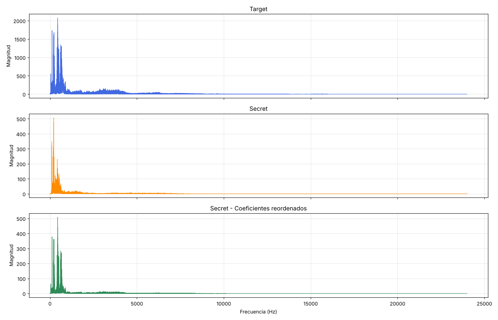
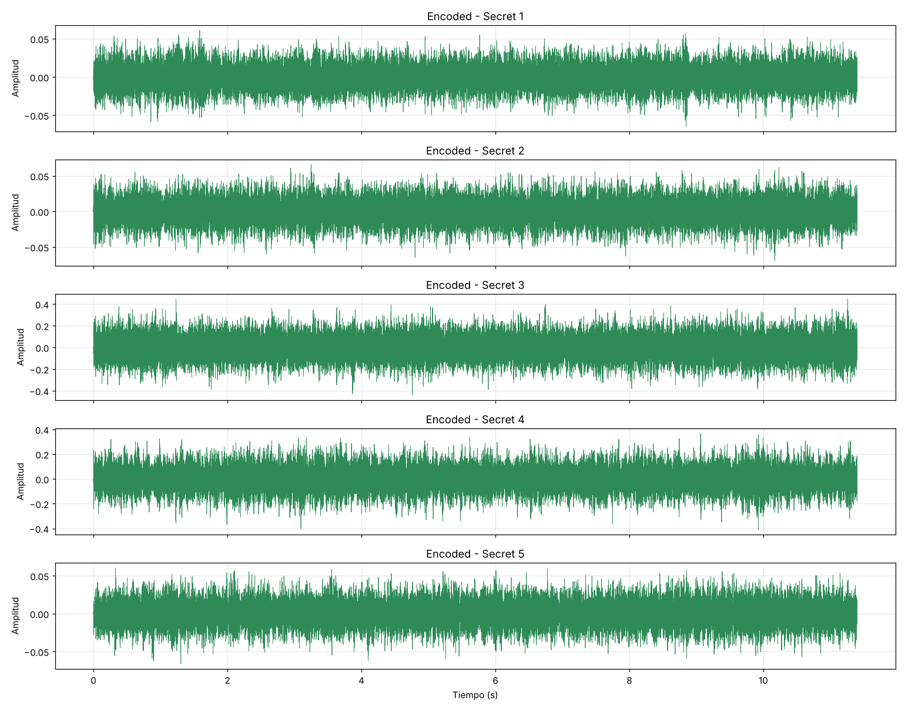

# Ocultamiento y recuperación de mensajes de audio mediante permutación espectral

**Análisis de Señales — Universidad Militar Nueva Granada**
**Profesora:** Dora María Ballesteros Larrotta
**Integrantes:** Andrés Felipe David · María Camila Rojas

## Contenido del repositorio

| Archivo / carpeta | Contenido |
|---|---|
| `Proyecto_Permutacion_Espectral.ipynb` | Preparación de audios, **Imitation**, **Reverse** y **métricas (SNR y Pearson)** |
| `Reverse_FFT_GitHub.ipynb` | Código Reverse suministrado por la profesora |
| `audios_grabados/` | Grabaciones originales del grupo (Target y 5 Secrets) |
| `audios_originales/` | Audios preparados: mono, misma $f_s$ y mismo número de muestras |
| `encoded/` | `encoded_secret1.wav` … `encoded_secret5.wav` |
| `claves/` | `FFT_key_secret1.csv` … `FFT_key_secret5.csv` |
| `recuperados/` | `recovered_secret1.wav` … `recovered_secret5.wav` |
| `figuras/` | Gráficas generadas |
| `resultados_metricas.csv` | SNR y correlación de Pearson de los cinco mensajes |

**Ejecución:** abrir `Proyecto_Permutacion_Espectral.ipynb` (Jupyter o Google Colab) y ejecutar todas las celdas.
Requisitos: `numpy`, `scipy`, `matplotlib` y `ffmpeg` (para los archivos `.m4a`).

## Audios

| Audio | Grabación | $f_s$ original | Duración |
|---|---|---:|---:|
| Target | Bienvenida | 48 000 Hz | 8.50 s |
| Secret 1 | Grabación 3 (`.m4a`) | 16 000 Hz | 7.17 s |
| Secret 2 | Grabación 4 (`.m4a`) | 16 000 Hz | 6.85 s |
| Secret 3 | Números | 48 000 Hz | 11.40 s |
| Secret 4 | Susurro | 48 000 Hz | 5.10 s |
| Secret 5 | Grabación 6 (`.m4a`) | 16 000 Hz | 6.72 s |

Para emparejar coeficientes, todos los audios se llevaron a mono, a $f_s = 48\,000$ Hz y se completaron con
silencio al final hasta la duración del más largo: $N = 547\,200$ muestras y $M = N/2 + 1 = 273\,601$
coeficientes de `rfft`. Como $N$ es par, los coeficientes DC y Nyquist se mantienen fijos.

## Imitation

```python
P  = np.arange(1, M - 1)
I1 = np.argsort(np.abs(S[P]))
I2 = np.argsort(np.abs(T[P]))
K  = np.arange(M)
K[P[I2]] = P[I1]
E  = S[K]
encoded = irfft(E, n=N)
```

El audio codificado se guarda en `float32` y la clave en `.csv` con una fila de encabezado, formato que
lee directamente el código Reverse.





## Resultados

| Mensaje secreto | SNR (dB) | Correlación de Pearson |
|---|---:|---:|
| Secret 1 | **152.40** | 1.000000000000 |
| Secret 2 | 152.24 | 1.000000000000 |
| Secret 3 | 152.19 | 1.000000000000 |
| Secret 4 | 152.32 | 1.000000000000 |
| Secret 5 | 152.33 | 1.000000000000 |

SNR según el formato en que se guarda el audio codificado:

| Mensaje | Sin guardar | `float32` (usado) | `int16` |
|---|---:|---:|---:|
| Secret 1 | 302.8 dB | 152.40 dB | 88.20 dB |
| Secret 2 | 302.8 dB | 152.24 dB | 88.48 dB |
| Secret 3 | 302.8 dB | 152.19 dB | 88.01 dB |
| Secret 4 | 302.8 dB | 152.32 dB | 87.86 dB |
| Secret 5 | 302.7 dB | 152.33 dB | 88.39 dB |

## Análisis

**Mejor recuperación.** El Secret 1 obtuvo la mayor SNR (152.40 dB) y el Secret 3 la menor (152.19 dB).

**Similitud entre los cinco resultados.** Los cinco valores son prácticamente iguales: la diferencia entre
el mejor y el peor es de 0.21 dB, es decir, la energía del error del Secret 3 es solo ≈ 5 % mayor que la
del Secret 1. Una SNR de ≈ 152 dB indica que la energía del error es unas $10^{15}$ veces menor que la del
mensaje, por lo que los cinco audios recuperados son inaudiblemente distintos de los originales.

Los resultados no dependen del volumen, de la $f_s$ original ni de la duración de cada grabación. Los
secretos 1, 2 y 5 (grabados con celular) tienen un valor RMS unas 6–7 veces menor que los secretos 3 y 4,
y su error también es 6–7 veces menor, de modo que la SNR se mantiene. Esto ocurre porque el redondeo de
`float32` es relativo al tamaño de cada muestra; las pequeñas diferencias de décimas de dB dependen de
cómo se distribuyen las muestras de cada audio codificado entre potencias de 2.

**Correlación de Pearson.** En los cinco casos $\rho = 1.000000000000$: las formas de onda recuperadas son
idénticas a las originales. Con un error tan pequeño, $1-\rho \approx \tfrac12 10^{-SNR/10} \approx
3\times10^{-16}$, que está en el límite de precisión de `float64`, así que Pearson no permite ordenar los
cinco audios; la SNR sí refleja las pequeñas diferencias. Además, Pearson no detecta cambios de escala o
de nivel DC (un audio amplificado ×2 seguiría dando 1), mientras que la SNR sí. Por eso ambas métricas se
complementan: Pearson confirma que la forma de onda es la misma y la SNR cuantifica el error.

**Error después de guardar y volver a cargar.** La permutación es exactamente reversible: sin guardar el
audio, la SNR es ≈ 303 dB, que corresponde solo al redondeo numérico de `float64`. El error aparece al
escribir el `.wav`: cada muestra del audio codificado se cuantiza al formato del archivo (`float32`,
24 bits de mantisa ≈ 6 dB × 24 ≈ 150 dB). Ese error de cuantización pasa por la `rfft`, se reparte entre
todos los coeficientes y, al deshacer la permutación, queda como un ruido muy débil sobre el mensaje. Si el
audio codificado se guardara en `int16`, el paso de cuantización sería fijo y la SNR bajaría a ≈ 88 dB.

**Conclusión.** El procedimiento de Imitation genera cinco audios codificados que suenan como ruido y que,
con su clave, el Reverse recupera con SNR ≈ 152 dB y correlación igual a 1. La única fuente de error es la
cuantización al guardar el archivo de audio.
